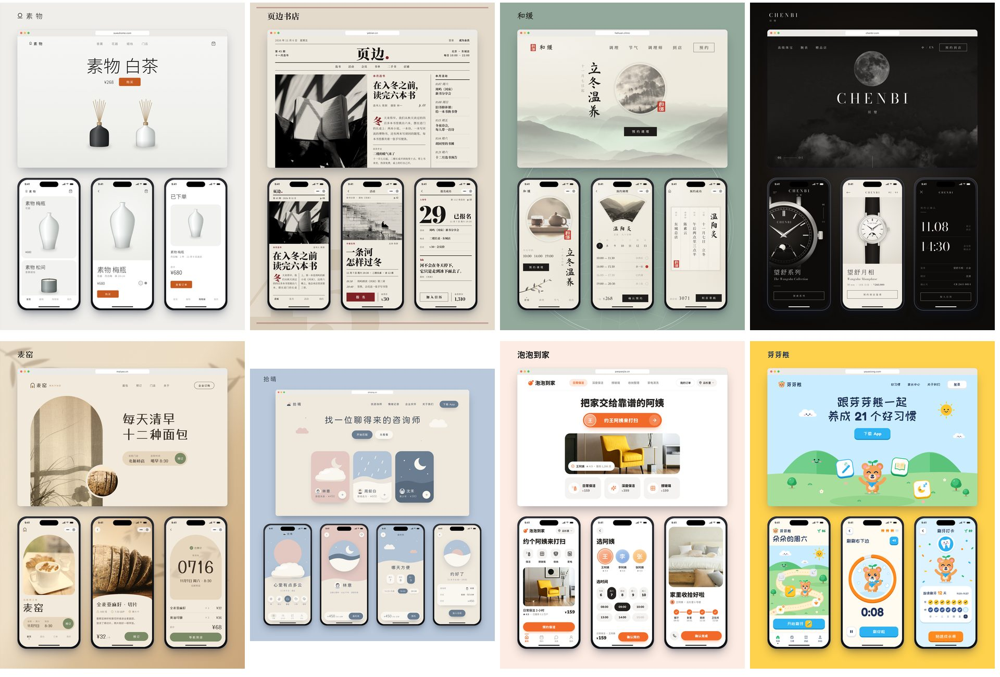
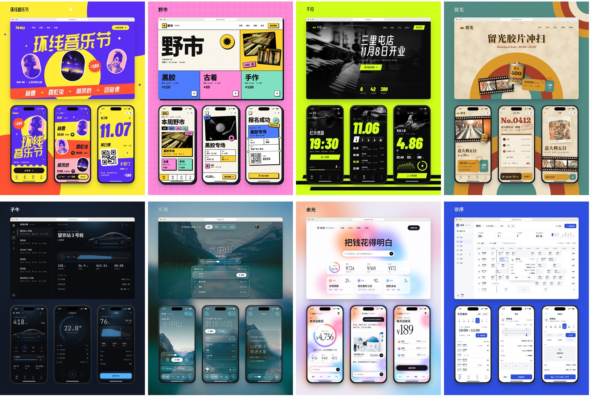

# visual-styles

十六种界面视觉风格的 Claude Code 技能。说一句「要新中式那种」或者「按第 05 种出两套首页」，它就用客户自己的店名和商品做一套 demo：每屏 PNG、一张展示板、一个发出去就能点的单文件 HTML。

风格来自模方科技的图册《您的软件想长什么样》。





## 十六种风格

| 气质 | 风格 |
|---|---|
| 安静高级 | 01 留白极简、02 杂志编辑、03 新中式、04 黑白奢感 |
| 温暖亲和 | 05 暖调自然、06 柔和治愈、07 亲和圆润、08 插画童趣 |
| 张扬有劲 | 09 撞色波普、10 新粗野主义、11 运动能量、12 复古胶片 |
| 科技专业 | 13 暗夜科技、14 液态玻璃、15 弥散光、16 清晰专业 |

每种风格都有设计规范（`styles/`）、起手组件包（`kit/styles/`）、图册原图（`refs/`）和一个换了行业的完整样例（`examples/`）。

## 安装

需要 Node 22 以上、Python 3、curl、rsync、Google Chrome 或 Chromium。在 macOS 上测过，Linux 没有实测。

```bash
git clone https://github.com/CavemaninIceAge/visual-styles.git ~/.claude/skills/visual-styles
bash ~/.claude/skills/visual-styles/tools/setup.sh
```

`setup.sh` 会下载约 170MB 字体和 70MB 照片，放在 `~/.cache/visual-styles`。需要代理时先设 `https_proxy`。

## 用法

在 Claude Code 里直接说：

```
给松间民宿做小程序首页，05 暖调自然为主，借一点 03 新中式，松绿、米白、木色，出两套
```

入口是 `SKILL.md`，选风格看 `选风格.md`，每一屏要守的规矩在 `审美守则.md`。

不用 Claude Code 时，也可以手动跑：

```bash
K=~/.claude/skills/visual-styles
bash $K/tools/new_demo.sh ~/demos/songjian-20261106 05 "松间民宿" mini   # 建项目，改 demo.js
bash $K/tools/render.sh ~/demos/songjian-20261106                        # 出图和自动检查
bash $K/tools/pack.sh ~/demos/songjian-20261106 "松间民宿-可点击演示"     # 打单文件 HTML
```

结果在项目的 `out/` 里。出图只用无头 Chrome，不开窗口。

## 在另一台机器上出图

这台机器不跑 Node 时，可以把出图放到一台能 ssh 连上的 Mac。复制 `tools/config.example.sh` 成 `tools/config.local.sh`，写上主机名和目录，工具会自动同步过去、跑完把结果拉回来。

## 自己的规矩

技能目录下放一份 `本地约定.md`，写上团队自己的规矩，比如客户资料在哪、成品放哪。这个文件不进仓库，`SKILL.md` 会让 Claude 先读它。

## 授权

代码、文档和设计规范用 [MIT](LICENSE)。字体、照片、图标的授权见 [THIRD_PARTY.md](THIRD_PARTY.md)。
